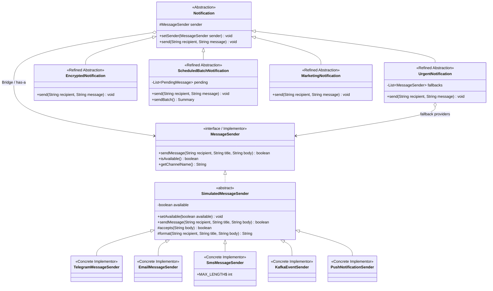

# Multi-Channel Notification Gateway — Bridge Pattern

Учебное задание №3 по Software Design Patterns. Java 21, Gradle, JUnit 5.
Все каналы симулируются: сообщения печатаются в консоль, внешние API и учётные данные не нужны.

## Запуск и проверка

Требуются JDK 21+ и доступ к интернету при первом запуске для загрузки Gradle и зависимостей.

```bash
./gradlew :app:run
./gradlew :app:test
./gradlew :app:build
```

На Windows используйте `gradlew.bat` вместо `./gradlew`.
Проект использует Java toolchain 21; Gradle может загрузить его автоматически.
HTML-отчёт тестов: `app/build/reports/tests/test/index.html`.

## Демонстрация

`app/src/main/java/org/example/Main.java` последовательно показывает:

1. `UrgentNotification + TelegramMessageSender` — сообщение с `[URGENT]`.
2. `EncryptedNotification + EmailMessageSender` — преобразование UTF-8 сообщения в Base64.
3. `ScheduledBatchNotification + SmsMessageSender` — три получателя, два успеха и один отказ из-за длины.
4. Переключение того же объекта `urgent` с Telegram на Email через `setSender()`.
5. Недоступный Telegram и успешная отправка через резервный SMS.
6. `MarketingNotification + PushNotificationSender` — расширение обеих независимых иерархий.
7. Дополнительно: `EncryptedNotification + KafkaEventSender` — публикация события.

Итог пакета в демонстрации:

```text
Total: 3
Successful: 2
Failed: 1
```

## Поведение

- Telegram оформляет заголовок тегом `<b>`; Email выводит тему и подпись.
- SMS отправляет только тело: максимум `SmsMessageSender.MAX_LENGTH = 160` Unicode code points. Длинные сообщения отклоняются без обрезания. Префиксы и преобразования уведомлений учитываются в итоговой длине. Это учебное ограничение, а не моделирование GSM-сегментации.
- Kafka печатает событие с получателем, заголовком и полезной нагрузкой; Push имитирует уведомление устройства.
- Любой провайдер можно отключить через `setAvailable(false)`. Недоступный провайдер возвращает `false`, не публикуя сообщение.
- Срочное уведомление сначала проверяет доступность основного канала. При недоступности или отказе отправки последовательно пробует резервные каналы через интерфейс `MessageSender`. Первый успех прекращает попытки; полный отказ явно выводится. Резервная отправка не меняет основной канал.
- Base64 — обратимое кодирование для выполнения учебного условия, не защищённое шифрование.
- `ScheduledBatchNotification.send(recipient, message)` ставит доставку в очередь. `sendBatch()` отправляет очередь текущим провайдером, возвращает `Summary`, печатает статистику и очищает очередь, включая неуспешные доставки. Момент запуска задаёт вызывающий код; фонового таймера нет. Пустой пакет даёт три нуля. Повторяющиеся получатели разрешены как отдельные доставки.
- Некорректный ввод уведомления вызывает `IllegalArgumentException`; `null` вместо провайдера — `NullPointerException`. Провайдеры возвращают `false` для недопустимого ввода. Ожидаемые ошибки доставки представлены результатом `boolean`.

## UML Class Diagram

GitHub отображает следующую диаграмму Mermaid. Общий базовый класс симуляторов содержит только техническую логику провайдеров.



## Ответы на вопросы

1. **Два независимых измерения:** политика уведомления (срочное, преобразованное, пакетное, маркетинговое) и канал доставки (Telegram, Email, SMS, Kafka, Push).
2. **Где Bridge:** поле `protected MessageSender sender` в `Notification`. Абстракция делегирует доставку этому объекту через интерфейс; конструктор и `setSender()` позволяют выбрать реализацию.
3. **Почему одного наследования недостаточно:** классы вроде `UrgentTelegramNotification` и `UrgentEmailNotification` дублируют политику и доставку. Для N типов и M каналов возникает N × M комбинаций. Bridge разделяет их на N + M реализаций двух измерений.
4. **Новый провайдер:** реализуем `MessageSender` либо наследуем общий симулятор. `PushNotificationSender` добавляет только поведение Push и сразу работает с существующими уведомлениями. Их исходники менять не требуется.
5. **Новый тип уведомления:** наследуем `Notification`, определяем политику и вызываем методы `sender`. `MarketingNotification` добавляет промопрефикс и инструкцию отписки, работая со всеми существующими провайдерами без их изменения. Возможный отказ SMS из-за длины остаётся правилом самого SMS.
6. **Почему Bridge, а не Adapter:** архитектура заранее разделяет две независимо расширяемые иерархии и связывает их композицией. Здесь нет чужого несовместимого интерфейса, который требуется приспособить. Adapter решал бы именно такую задачу совместимости.

Ни одна абстракция не импортирует конкретные провайдеры и не использует `instanceof`. Конкретные комбинации собирает только клиентский код `Main`.

## Тесты

`NotificationGatewayTest` содержит 21 JUnit 5-тест: успешная отправка всеми провайдерами, недоступность, префикс срочности, резервирование при недоступности и отказе, несколько резервов, полный отказ, границы SMS 160/161 и Unicode, Base64/UTF-8, отложенная отправка пакета, частичный и полный отказ пакета, очистка очереди, runtime-переключение, Push со старым типом, Marketing со всеми провайдерами, валидация и различия форматов.

## Подготовка к защите

- Начните с поля `Notification.sender`, затем покажите вызов `sender.sendMessage()` и две иерархии на UML.
- Для WhatsApp добавьте класс в `org.example.sender`, реализующий `MessageSender` или наследующий `SimulatedMessageSender`, и передайте его существующему уведомлению.
- Для лимита SMS 120 измените `MAX_LENGTH` и граничные тесты.
- Для `SilentNotification` создайте наследника `Notification` с нужной политикой отправки.
- Для отключения Email вызовите `email.setAvailable(false)`; срочному уведомлению передайте резервный канал или переключите провайдер через `setSender()`.
- Несколько резервов задаются конструктором: `new UrgentNotification(telegram, sms, email)`.
- После изменения выполните тесты и демонстрацию командами выше.

Для сдачи загрузите проект в свой GitHub-репозиторий и передайте ссылку через Moodle. README содержит UML и объяснение архитектуры.
